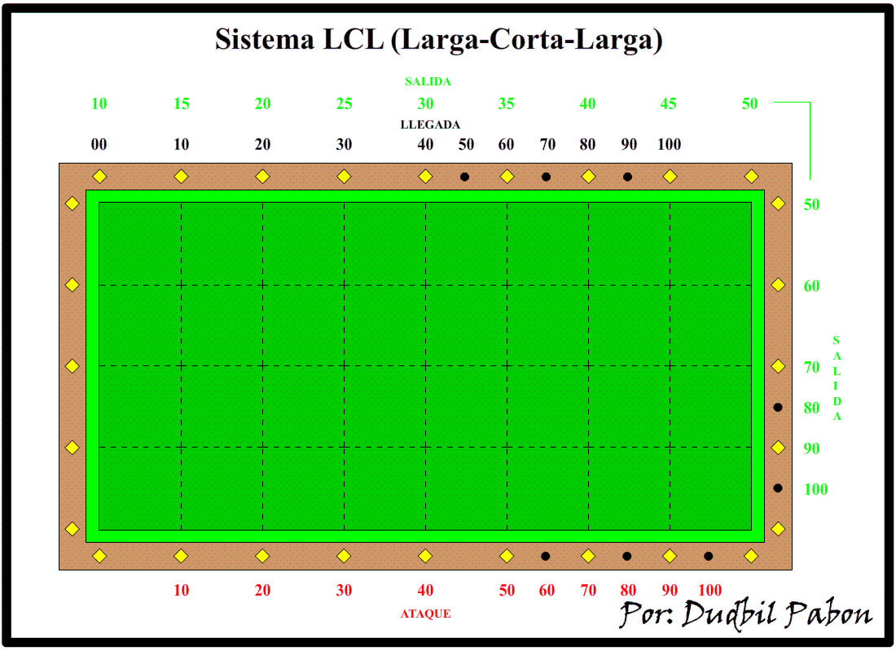
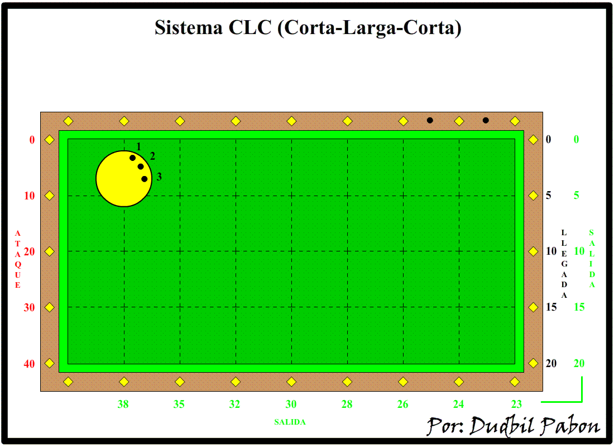
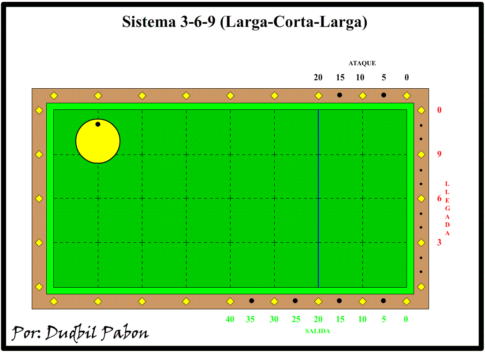
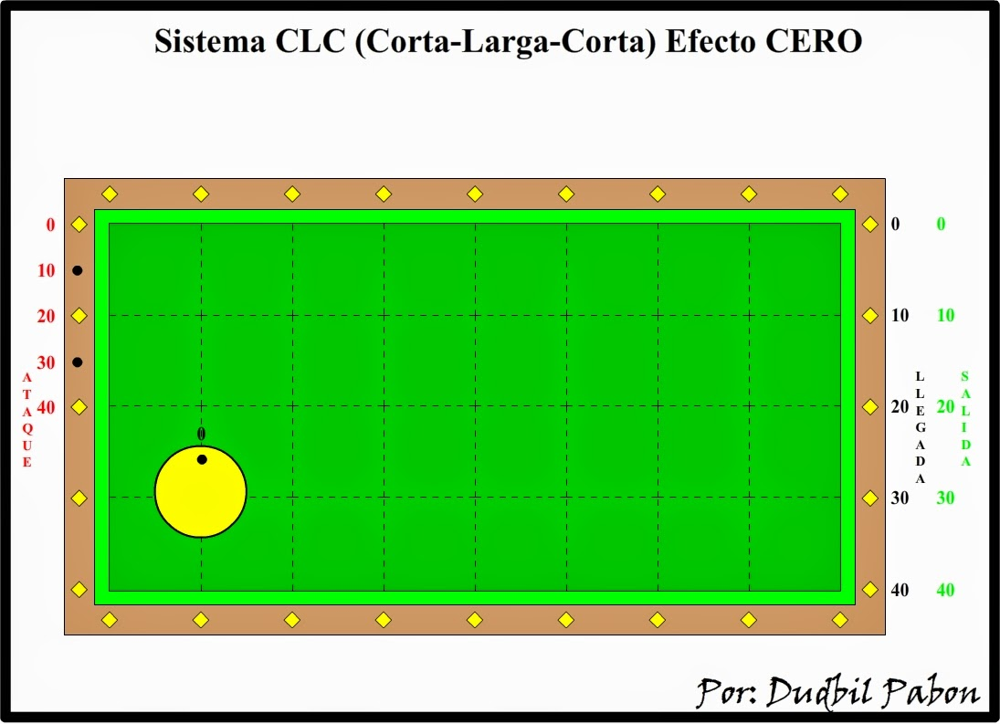
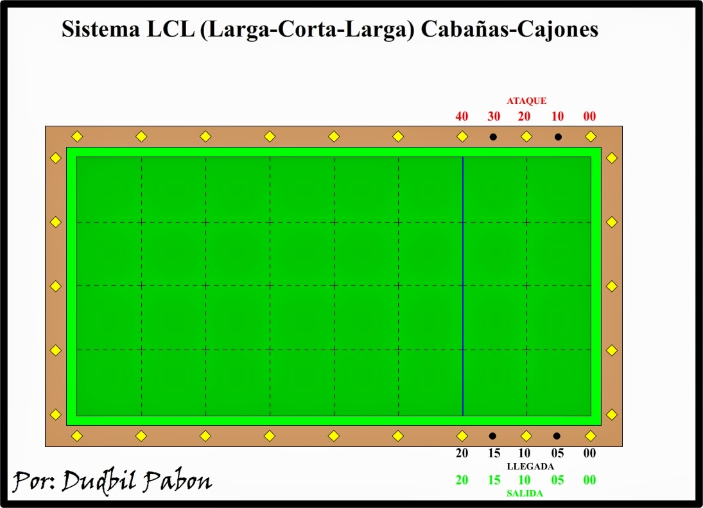
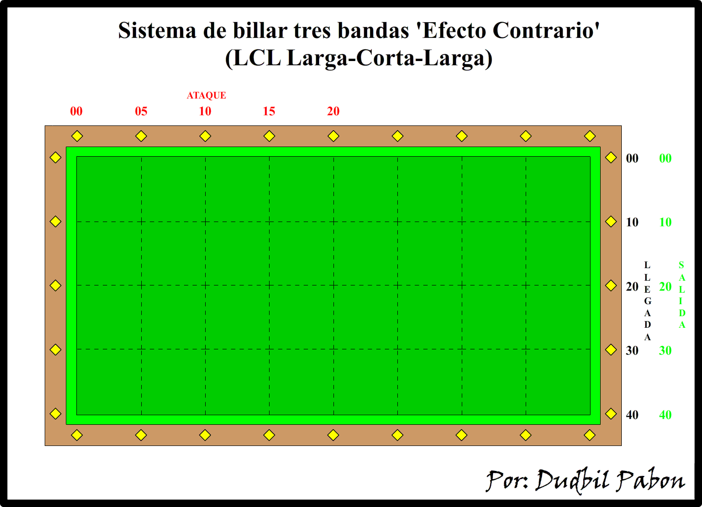
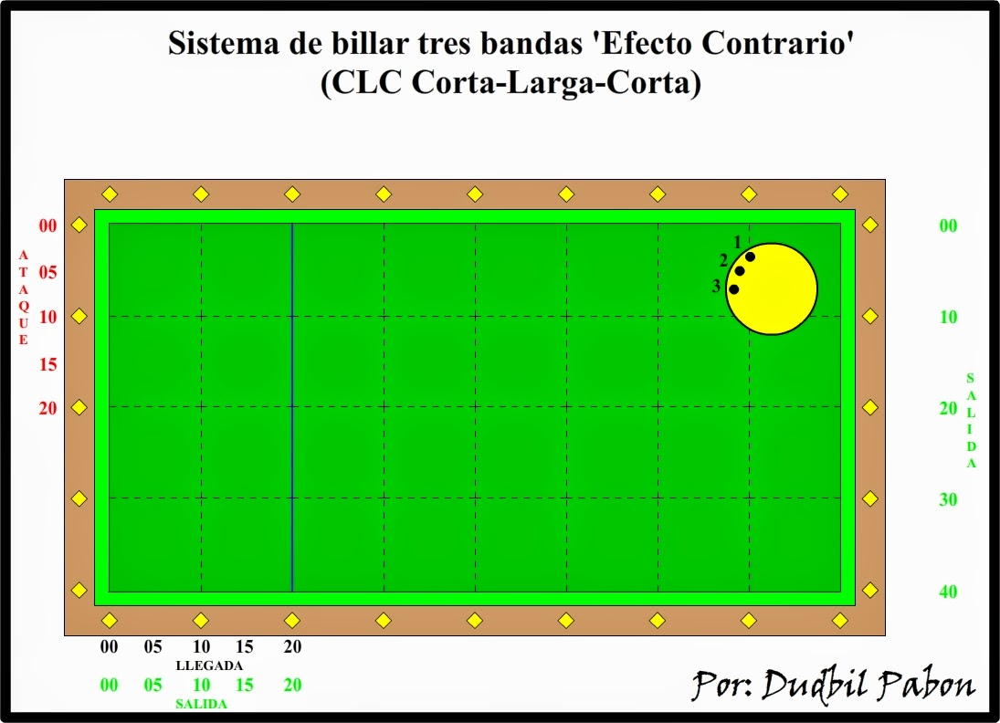
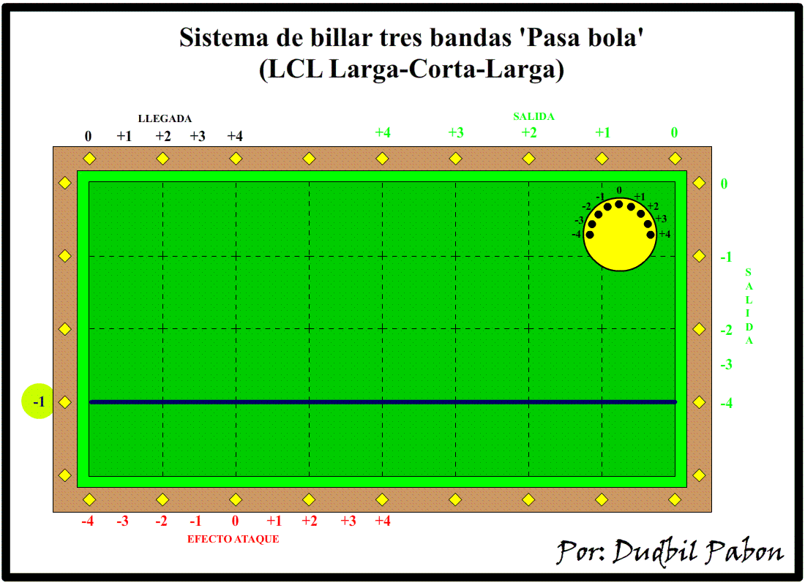
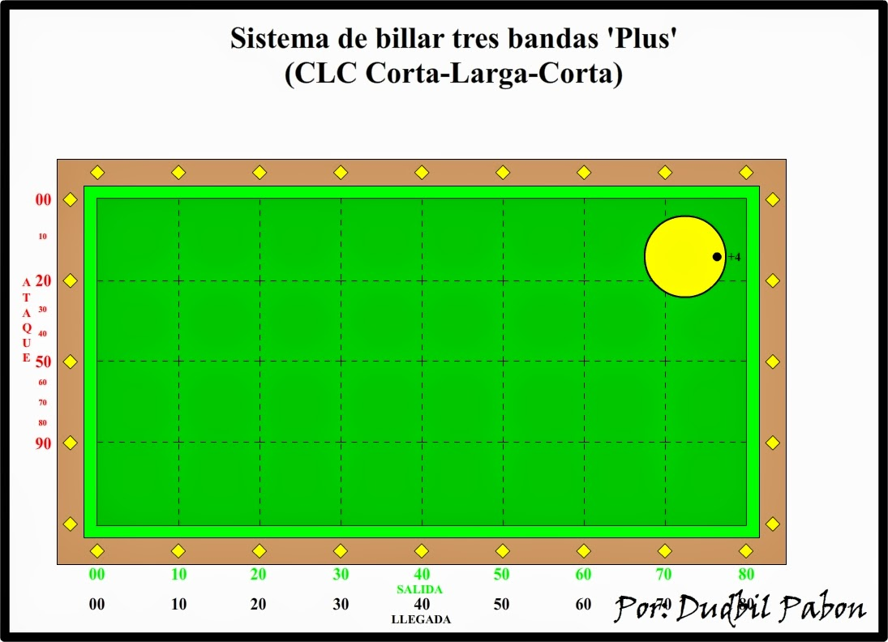

# Los nueve sistemas de diamantes

Documento generado por `scripts/generar_docs.py` desde `data/sistemas.json`. Sistemas publicados por Dudbil Pabón en el blog *Bases de billar tres bandas* (2014–2015); los sistemas de diamantes son tradición del juego y aquí se documentan, se corrigen y se ponen a prueba.

**Mesa:** Mesa de carambola en unidades de diamante: 8 intervalos en la banda larga y 4 en la corta. Origen en la esquina inferior izquierda de las figuras de 2015.

**Escalas:** Las posiciones se leyeron de las figuras originales del blog (2014-2015). En las bandas sup/inf la posicion es x (0 a 8); en izq/der es y (0 a 4). Entre marcas se interpola linealmente.

## 1. LCL (Larga-Corta-Larga)

Publicado: 2014-05-31 · Familia: LCL

$$
\text{ATAQUE} = \text{SALIDA} - \text{LLEGADA}
$$

**Efecto:** Efecto máximo del lado de la trayectoria (efecto 3 a la derecha en la figura).

| Variable | Banda | Marcas (valor → posición en diamantes) |
|---|---|---|
| SALIDA | banda larga superior (y = 4) | 10 → 0, 15 → 1, 20 → 2, 25 → 3, 30 → 4, 35 → 5, 40 → 6, 45 → 7, 50 → 8 |
| SALIDA | banda corta derecha (x = 8) | 50 → 4, 60 → 3, 70 → 2, 80 → 1.5, 90 → 1, 100 → 0.5 |
| LLEGADA | banda larga superior (y = 4) | 0 → 0, 10 → 1, 20 → 2, 30 → 3, 40 → 4, 50 → 4.5, 60 → 5, 70 → 5.5, 80 → 6, 90 → 6.5, 100 → 7 |
| ATAQUE | banda larga inferior (y = 0) | 10 → 1, 20 → 2, 30 → 3, 40 → 4, 50 → 5, 60 → 5.5, 70 → 6, 80 → 6.5, 90 → 7, 100 → 7.5 |

**Ejemplos del blog (pruebas automáticas en `tests/`):** S = 50, L = 0 ⇒ 50

## 2. CLC (Corta-Larga-Corta)

Publicado: 2015-01-14 · Familia: CLC

$$
\text{ATAQUE} = \text{AVANCE} + (\text{SALIDA} - \text{LLEGADA})
$$

**Efecto (a favor de la trayectoria) → AVANCE:** efecto 1 → 5, efecto 2 → 10, efecto 3 → 15

| Variable | Banda | Marcas (valor → posición en diamantes) |
|---|---|---|
| SALIDA | banda corta derecha (x = 8) | 0 → 4, 5 → 3, 10 → 2, 15 → 1, 20 → 0 |
| SALIDA | banda larga inferior (y = 0) | 23 → 8, 24 → 7, 26 → 6, 28 → 5, 30 → 4, 32 → 3, 35 → 2, 38 → 1 |
| LLEGADA | banda corta derecha (x = 8) | 0 → 4, 5 → 3, 10 → 2, 15 → 1, 20 → 0 |
| ATAQUE | banda corta izquierda (x = 0) | 0 → 4, 10 → 3, 20 → 2, 30 → 1, 40 → 0 |

**Ejemplos del blog (pruebas automáticas en `tests/`):** S = 20, L = 0, efecto = 3 ⇒ 35

## 3. 3-6-9 (Larga-Corta-Larga)

Publicado: 2015-01-15 · Familia: LCL

$$
\text{ATAQUE} = \begin{cases} \dfrac{\text{SALIDA} - \text{LLEGADA}}{2}, & \text{SALIDA} \le 20 \\[6pt] \dfrac{\text{SALIDA}}{2} - \text{LLEGADA}, & \text{SALIDA} > 20 \end{cases}
$$

**Efecto:** Efecto alto a favor (marca superior de la bola en la figura).

| Variable | Banda | Marcas (valor → posición en diamantes) |
|---|---|---|
| SALIDA | banda larga inferior (y = 0) | 0 → 8, 5 → 7.5, 10 → 7, 15 → 6.5, 20 → 6, 25 → 5.5, 30 → 5, 35 → 4.5, 40 → 4 |
| LLEGADA | banda corta derecha (x = 8) | 0 → 0, 3 → 1, 6 → 2, 9 → 3, 12 → 4 |
| ATAQUE | banda larga superior (y = 4) | 0 → 8, 5 → 7.5, 10 → 7, 15 → 6.5, 20 → 6 |

**Ejemplos del blog (pruebas automáticas en `tests/`):** S = 16, L = 6 ⇒ 5; S = 36, L = 3 ⇒ 15

> ⚠️ **Errata:** El blog dice 'si el valor de ataque es <= 20', pero ese valor es el que se calcula. Los dos ejemplos solo cuadran si la condición se aplica a la SALIDA (16 usa la ec. 1; 36 usa la ec. 2). En la escala de llegada la figura rotula 0 (esquina superior), 9, 6, 3 de arriba hacia abajo: los valores bajan un 3 por diamante. Por continuidad se toma la esquina inferior como 0 y la superior como 12 (lectura a confirmar por el autor).

## 4. CLC Efecto cero

Publicado: 2015-01-18 · Familia: CLC

$$
\text{ATAQUE} = \text{SALIDA} - 1.5\,\text{LLEGADA}
$$

**Efecto:** Sin efecto lateral (bola al centro, un poco arriba).

| Variable | Banda | Marcas (valor → posición en diamantes) |
|---|---|---|
| SALIDA | banda corta derecha (x = 8) | 0 → 4, 10 → 3, 20 → 2, 30 → 1, 40 → 0 |
| LLEGADA | banda corta derecha (x = 8) | 0 → 4, 10 → 3, 20 → 2, 30 → 1, 40 → 0 |
| ATAQUE | banda corta izquierda (x = 0) | 0 → 4, 10 → 3.5, 20 → 3, 30 → 2.5, 40 → 2 |

**Ejemplos del blog (pruebas automáticas en `tests/`):** S = 30, L = 10 ⇒ 15

> Nota: Si la LLEGADA se renumera como 0, 15, 30, 45, 60, la ecuación queda ATAQUE = SALIDA - LLEGADA.

## 5. Cajones-Cabañas (LCL, efecto 1, 2 y 3)

Publicado: 2015-01-18 · Familia: LCL

$$
\text{ATAQUE} = \text{AVANCE} + (\text{SALIDA} - \text{LLEGADA})
$$

**Efecto (a favor de la trayectoria) → AVANCE:** efecto 1 → 5, efecto 2 → 10, efecto 3 → 15

| Variable | Banda | Marcas (valor → posición en diamantes) |
|---|---|---|
| SALIDA | banda larga inferior (y = 0) | 0 → 8, 5 → 7.5, 10 → 7, 15 → 6.5, 20 → 6 |
| LLEGADA | banda larga inferior (y = 0) | 0 → 8, 5 → 7.5, 10 → 7, 15 → 6.5, 20 → 6 |
| ATAQUE | banda larga superior (y = 4) | 0 → 8, 10 → 7.5, 20 → 7, 30 → 6.5, 40 → 6 |

**Ejemplos del blog (pruebas automáticas en `tests/`):** S = 15, L = 5, efecto = 1 ⇒ 15

## 6. Efecto contrario (LCL)

Publicado: 2015-01-20 · Familia: LCL

$$
\text{ATAQUE} = \left[\,2\,\text{AVANCE} - \text{LLEGADA}\,\right] - \text{SALIDA}
$$

**Efecto (contrario a la trayectoria) → AVANCE:** efecto 1 → 5, efecto 2 → 10, efecto 3 → 15

| Variable | Banda | Marcas (valor → posición en diamantes) |
|---|---|---|
| SALIDA | banda corta derecha (x = 8) | 0 → 4, 10 → 3, 20 → 2, 30 → 1, 40 → 0 |
| LLEGADA | banda corta derecha (x = 8) | 0 → 4, 10 → 3, 20 → 2, 30 → 1, 40 → 0 |
| ATAQUE | banda larga superior (y = 4) | 0 → 0, 5 → 1, 10 → 2, 15 → 3, 20 → 4 |

**Ejemplos del blog (pruebas automáticas en `tests/`):** S = 5, L = 10, efecto = 2 ⇒ 5

> ⚠️ **Errata:** El texto del blog dice SALIDA = 10 y LLEGADA = 5, pero la ecuación resuelta usa LLEGADA = 10 y SALIDA = 5. Se toma la ecuación como correcta.

## 7. Efecto contrario (CLC)

Publicado: 2015-01-25 · Familia: CLC

$$
\text{ATAQUE} = (\text{AVANCE} - \text{LLEGADA}) - \text{SALIDA}
$$

**Efecto (contrario a la trayectoria) → AVANCE:** efecto 1 → 5, efecto 2 → 10, efecto 3 → 15

| Variable | Banda | Marcas (valor → posición en diamantes) |
|---|---|---|
| SALIDA | banda larga inferior (y = 0) | 0 → 0, 5 → 0.5, 10 → 1, 15 → 1.5, 20 → 2 |
| SALIDA | banda corta derecha (x = 8) | 0 → 4, 10 → 3, 20 → 2, 30 → 1, 40 → 0 |
| LLEGADA | banda larga inferior (y = 0) | 0 → 0, 5 → 0.5, 10 → 1, 15 → 1.5, 20 → 2 |
| ATAQUE | banda corta izquierda (x = 0) | 0 → 4, 5 → 3.5, 10 → 3, 15 → 2.5, 20 → 2 |

**Ejemplos del blog (pruebas automáticas en `tests/`):** S = 5, L = 8, efecto = 3 ⇒ 2

> ⚠️ **Errata:** La SALIDA tiene dos escalas (banda corta derecha y banda inferior). El ejemplo del blog (salida 5, bolas junto a la esquina inferior izquierda) usa la inferior.

## 8. Pasa bola (LCL)

Publicado: 2015-01-31 · Familia: LCL

$$
\text{EFECTO} = \text{AVANCE} + \text{LLEGADA} + \text{SALIDA} + \text{ATAQUE}
$$

**Efecto:** AVANCE = -1 si la bola a atacar está a un diamante de la primera banda; si no, 0. El resultado es la cantidad de efecto (de -4 a +4).

| Variable | Banda | Marcas (valor → posición en diamantes) |
|---|---|---|
| SALIDA | banda larga superior (y = 4) | 4 → 4, 3 → 5, 2 → 6, 1 → 7, 0 → 8 |
| SALIDA | banda corta derecha (x = 8) | 0 → 4, -1 → 3, -2 → 2, -3 → 1.5, -4 → 1 |
| LLEGADA | banda larga superior (y = 4) | 0 → 0, 1 → 0.5, 2 → 1, 3 → 1.5, 4 → 2 |
| ATAQUE | banda larga inferior (y = 0) | -4 → 0, -3 → 0.5, -2 → 1, -1 → 1.5, 0 → 2, 1 → 2.5, 2 → 3, 3 → 3.5, 4 → 4 |

**Ejemplos del blog (pruebas automáticas en `tests/`):** S = 0, L = 2, A = 2, V = 0 ⇒ 4

## 9. Plus (CLC)

Publicado: 2015-02-01 · Familia: CLC

$$
\text{ATAQUE} = \text{LLEGADA} - \text{SALIDA}
$$

**Efecto:** Efecto +4 (máximo, a favor).

| Variable | Banda | Marcas (valor → posición en diamantes) |
|---|---|---|
| SALIDA | banda larga inferior (y = 0) | 0 → 0, 10 → 1, 20 → 2, 30 → 3, 40 → 4, 50 → 5, 60 → 6, 70 → 7, 80 → 8 |
| LLEGADA | banda larga inferior (y = 0) | 0 → 0, 10 → 1, 20 → 2, 30 → 3, 40 → 4, 50 → 5, 60 → 6, 70 → 7, 80 → 8 |
| ATAQUE | banda corta izquierda (x = 0) | 0 → 4, 10 → 3.5, 20 → 3, 30 → 2.75, 40 → 2.5, 50 → 2, 60 → 1.75, 70 → 1.5, 80 → 1.25, 90 → 1 |

**Ejemplos del blog (pruebas automáticas en `tests/`):** S = 30, L = 70 ⇒ 40
